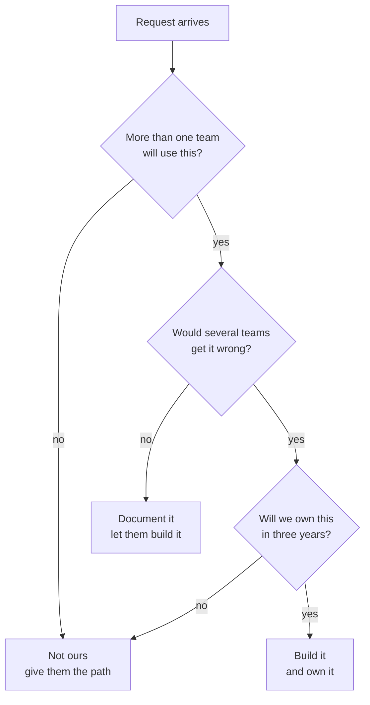

Most writing about platform engineering is about what to build. Very little of it is about what to refuse, which is strange, because refusing is most of the job.

<!-- more -->

Every platform team I have worked on has had a remit larger than its headcount. That is not a staffing problem to be fixed later. It is the permanent condition, and the teams that do well are the ones that treat deciding *what not to do* as real work rather than as an admission of failure.

## 1. The remit is always bigger than the team

The arithmetic does not work and it never will. A platform team supports every other team, so its potential work grows with the organisation while its headcount grows with whatever budget argument was won last year.

What follows from that is uncomfortable: **if you do not choose what to drop, the choice gets made for you**, by whoever asks loudest or most recently. That is the worst possible prioritisation function, because volume correlates with frustration rather than with value.

The alternative is not a better backlog tool. It is being willing to say, out loud and in public, that something is not going to be done.

!!! example "What queue-driven prioritisation looks like from the inside"

    *This section is an argument rather than a specific recollection.* The failure mode is not dramatic. Every individual request is reasonable. Each one takes a day or two. Nobody is being unreasonable and nothing is being mismanaged.

    Six months later the team has shipped nothing it planned, every engineer can list four things they are halfway through, and the thing everyone agreed was the most valuable work has not been started.

    No single decision caused that. The absence of decisions caused it.

## 2. Three questions before taking something on

What I use, roughly in this order:

| Question | If no |
|---|---|
| Will more than one team use it? | It belongs to the team that wants it |
| Is it harder to explain than to build? | Write the documentation instead |
| Would several teams otherwise build it badly? | Let them build it, and watch |

The third one is the only argument I find genuinely convincing for centralising something. Not efficiency, and not consistency for its own sake — those are arguments platform teams like, and application teams correctly hear as "we want control". The real argument is that some things are hard enough to get wrong that five independent attempts will produce five subtly broken versions, and the cost of that lands on everyone later.

Signing is like that. Firewall rules are like that. A deployment script for one team's service is not.

!!! example "The one that is genuinely ours"

    Artifact signing is the clearest case I have. It is not that application teams could not implement signing. It is that the thing being protected — a key only the build can use — stops meaning anything the moment it is implemented five different ways with five different sets of assumptions about who can reach it.

    That is a control where one correct implementation is worth more than five reasonable ones, and that is the test. If the value of a thing comes from everybody doing it the same way, it belongs to the platform. If the value is local, it belongs to the team.

## 3. Taking something on is forever

The part that gets underestimated is not the build. It is that every piece of platform surface area is a permanent claim on the team's future capacity: support, upgrades, the week it breaks, the migration when the underlying thing changes.

So the question is never "can we build this". It is "are we prepared to own this in three years, with the team we will have then". A yes given casually in a planning meeting is a commitment nobody revisits, and the team that inherits it will not know why it was made.

This is also why "we'll build it and hand it over" almost never works. Handing over a system that nobody else asked to own is a slow way of keeping it.

!!! example "Keeping the guarded list short on purpose"

    The clearest version of this for me is the set of projects whose pipeline configuration we control centrally, where the team cannot change its own runner tags or remove the signing and verification steps.

    That list is deliberately short, and it stays short because every project on it is a project that waits on us for changes other teams make themselves. Adding one is not a config change. It is taking on a permanent obligation to be responsive for that team, forever.

    Every addition is a conversation rather than a default, and that is not bureaucracy. It is the only thing keeping the list at a size where we can actually be responsive to the projects on it.

## 4. A no needs a reason the other person can use

Most platform noes are technically correct and socially useless. "That's not on our roadmap" tells someone nothing except that they should ask again in a different way, or go around you.

A useful no has three parts: what you are not going to do, why, and what the person should do instead. The third part is the one that gets skipped, and it is the one that decides whether the team walks away with a path forward or with a grievance.

- **"We're not building that"** — a dead end.
- **"We're not building that, because it would only be used by your team. Here's the template to build it yourselves, and we'll review it."** — a path.

The second takes ten minutes longer and it is the difference between a platform team that is trusted and one that is routed around.

!!! example "The noes that come back"

    *Also a pattern rather than a specific incident.* A no that is not understood does not end the request. It relocates it: to a different channel, to a manager, to a workaround built quietly that you find out about a year later when it breaks.

    The ones that stay answered are the ones where the person left the conversation able to explain the reasoning to someone else. If they cannot repeat your reason, you have not said no — you have just declined, and the request is still live.

## 5. Self-service is how you say no at scale

Everything above is about individual requests. The structural version is self-service: the request you never receive because the person did it themselves.

This is the only mechanism I know that actually changes the arithmetic in section 1. Every other approach — better triage, more rigorous prioritisation, clearer intake forms — manages the queue. Self-service removes items from it permanently.

The catch is that self-service is itself platform surface area, and it is subject to the same rule: you own it forever. A self-service tool that is half-built generates more support load than the manual process it replaced, because now people need help with the thing *and* with the tool.

!!! example "Where moving a control creates a queue"

    *A prediction from the firewall work rather than something I have measured.* When a control moves off the application server and into infrastructure the platform team owns, the security position improves and a new queue appears: teams now wait on us for changes they used to make themselves.

    If that queue is not addressed, the control becomes the thing people design around. The answer is not to give the access back. It is to make the common change self-service — reviewable, auditable, and not gated on a conversation with us.

    That work is the actual cost of moving the control, and it is usually not in the estimate.

## 6. What I get wrong

I am better at the first half of this than the second. Deciding what not to take on, I can do. Saying it in a way that leaves the other team with a path, I get wrong often enough that I notice.

The specific failure is that a no feels final to me and provisional to them. I say it once, consider it settled, and move on. They hear a position that might soften if raised again next quarter. Both of us leave thinking the conversation ended.

## Takeaways

- **The remit is always bigger than the team.** If you do not choose what to drop, volume and recency choose for you.
- **Centralise what is dangerous to get wrong in parallel**, not what is merely repeated. Consistency alone is a weak argument and teams hear it as control.
- **Every yes is permanent.** Ask whether you will own it in three years with the team you will have then.
- **A no needs a reason the person can repeat to someone else**, and an alternative. Without those it is not answered, just relocated.
- **Self-service is the only thing that changes the arithmetic** — and it is platform surface area too, so half-building it costs more than not starting.

What I have not worked out is how to make these decisions visible. They happen in conversations and in the heads of whoever has been on the team longest, which means they are inconsistent across people and invisible to everyone outside it. A platform with a clear scope that nobody can read is not much better than one without a scope at all.
