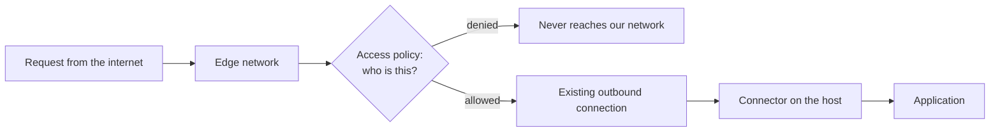

The usual way to put an application on the internet is to open a port. You put a load balancer in front, you write an inbound rule, and from then on anything on the internet can at least knock on the door. Every control after that is about deciding who gets in.

<!-- more -->

We went a different way: a connector on the host that dials out to an edge network, and not one inbound rule anywhere. The thing I did not expect is how much it let us delete — not just firewall rules, but the cloud provider's own peering between accounts and its managed DNS service as well.

## 1. The connection goes the other way

The mechanism is simple enough that it took me a while to believe it. A lightweight daemon runs on the host and opens an outbound connection to the edge network. Requests from the internet arrive at the edge first, and the edge sends them back down the connection that is already open.

Because the connection was established from the inside, nothing needs to listen for it. There is no inbound listener on the origin at all.

The connector keeps several connections open to different edge locations rather than one, so losing a location is not an outage. The transport is QUIC over UDP where it can be, falling back to HTTP/2 over TCP on the same port when UDP is unavailable.

| | Port opened on our side | What can reach the host |
|---|---|---|
| Load balancer and inbound rule | Inbound, from the internet | Anything that can route to the address |
| Outbound connector | None | Only what the edge sends down an existing connection |

!!! example "Reading the security group afterwards"

    The moment it clicked for me was looking at the instance's inbound rules after the cutover and finding nothing in them. Not a narrow rule. Not a rule restricted to the edge network's address ranges. An empty list.

    That is a different kind of statement from "we only allow traffic from these addresses". A narrow inbound rule is still a door, and the whole discipline of keeping it narrow — reviewing it, auditing it, catching the one someone widened for an afternoon and forgot — exists because the door exists. Remove the door and the discipline is no longer needed, which is worth more than the rule it replaced.

## 2. Outbound to the edge is the whole requirement

What we do allow is outbound, to the edge network's connector endpoints. Publicly, that is one port for the tunnel transport itself — both TCP and UDP, because of the QUIC-and-fallback behaviour — and optionally HTTPS for things like update checks and token validation, which the connector runs without if they are blocked.

That is a short list, and it is the kind of rule an outbound policy can be specific about: a named destination and a named port, rather than a range opened because something somewhere needs it.

!!! example "Why this is an easier conversation with security"

    An inbound rule is permission for the world to attempt something. An outbound rule is permission for one of our processes to reach one named place.

    Those are not the same risk, and they do not need the same review. The second one I can describe in a sentence and defend without a diagram, which matters more than it should when a control has to be explained to people who will not read the diagram.

## 3. Access decisions move to the edge, and that is the point

With no inbound path, the question "who may reach this site" stops being a network question. It becomes a policy question at the edge, in front of the application, where it can be expressed in terms of people and groups rather than addresses.

That is the part that made this worth doing rather than just clever. Address-based access control has always been a proxy for what we actually mean. We do not care what network someone is on; we care who they are. Moving the decision to the edge lets the rule say the thing we mean.

The consequence worth stating plainly: traffic arriving this way does not pass the host's own firewall rules on the way in, because it is not arriving from the network side. If your access control lives in those rules, it has to move to the edge as part of this change rather than after it.

!!! example "What we stopped having to model"

    The cross-account case is where this paid off most. Reaching a service in another account used to mean the cloud provider's own peering — connections between networks, route tables, non-overlapping address ranges, and a change in two accounts every time something moved.

    With connectors on both sides and policy at the edge, the networks do not have to meet. Each one dials out. The access decision is made in one place rather than expressed as the intersection of two sets of routes.

    I would not claim peering is obsolete. I would say that a surprising amount of what we used it for was reachability we could get another way, with less to keep in step.

## 4. It replaced the managed DNS service too

This one surprised me. Once the edge is in front of everything, the authoritative DNS may as well live there: a hostname points at the tunnel, the edge resolves it and routes it. We moved off the cloud provider's managed DNS entirely.

Two properties are worth knowing before you do the same:

- **The record and the tunnel are independent.** You can publish a hostname pointing at a tunnel that is not running, and visitors get an error rather than a failure that looks like DNS. That is clearer than it sounds — the failure names the tunnel rather than sending you to look at resolution.
- **A tunnel's identifier is not a credential.** Routing to it only works from within the same account, so knowing the identifier does not let someone else send traffic to your origin.

!!! example "The consolidation nobody asked for"

    We did not set out to change DNS. It came up because after the cutover the managed DNS service was doing nothing except pointing at something that no longer existed, and keeping it meant keeping two places where a hostname could be defined.

    Collapsing it was less about cost than about the number of systems that have to agree for a hostname to work. That number went from two to one, and the class of outage where they disagree went away with it.

## 5. What it saves, in resources and in effort

Two kinds of saving, and they are not the same kind of argument.

The first is resources that stop existing. Each of these is a billed thing in a native cloud design, and several of them are billed per environment, so the count multiplies quietly as you add a staging and a pre-production:

| Native cloud design | With an outbound connector |
|---|---|
| A public load balancer per entry point, with listeners, target groups and health checks | Not required — the edge is the entry point |
| Certificates to issue and renew at that balancer | Terminated at the edge |
| Peering relationships between accounts, with route tables and address-range planning | Not required — each side dials out |
| A separate managed DNS service, and its queries | Collapsed into the edge |

The second is effort, which nobody bills you for and which is the larger number:

- No inbound rules to review, widen by accident, or forget to narrow again.
- No route tables or address-range coordination to keep in step across accounts.
- One place where a hostname is defined, so no class of outage where two systems disagree about it.
- One place where access policy is expressed, in terms of identity rather than addresses.
- Host replacement does not involve a network change: the new host dials out the way the old one did.

That last one is the quiet win. Replacing an instance used to touch something in the network — a target registration, a rule, an address. Now it touches the connector and nothing else.

!!! example "Where the effort saving actually shows up"

    The resource list is the part that gets into a business case, and it is the less interesting half. The per-environment multiplication is real — balancers and peering relationships are things you need one of per environment, and the count grows without anyone deciding it should — but it is a number somebody can argue with.

    The effort saving is harder to put in a slide and easier to feel. It is the review that does not have to happen, the two-account change that is now a one-account change, the address-range conversation that nobody needs to have. None of that appears on an invoice, and all of it was coming out of the same engineers' weeks.

    *The costing here is structural rather than measured:* I am describing which line items and which recurring tasks stop existing, not a figure. Anyone making this case should count their own, because the balance depends entirely on how many environments and accounts you are running.

## 6. What you take on in exchange

*This section is the part I would want to read if someone else had written this post.*

**A dependency at the edge.** The edge network is now in the path of everything. That was true of a load balancer too, but this is a different vendor with a different failure mode, and the inbound path you would otherwise fall back to is gone by design. The answer is failover at the edge rather than a reopened door, which means a second location to route through — and that belongs in the plan from the start, not after the first time you need it.

**Access control in one place means one place to get wrong.** Everything that used to be distributed across network rules now lives in policy at the edge. That is better, and it concentrates the consequence of a mistake.

**Outbound UDP has to actually work.** If the transport port is blocked for UDP, the connector falls back to TCP and keeps working, which is good — and means a network restriction can quietly cost you performance rather than announce itself as an outage. Worth checking which transport you are actually on rather than assuming.

**The host firewall is no longer in the request path.** Said above, worth repeating, because it is the mistake I would expect someone to make: leaving access rules on the host and believing they still apply to traffic arriving through the tunnel.

## Takeaways

- **A connector that dials out removes the door**, rather than narrowing it. There is no inbound listener to protect.
- **The requirement on your side is one outbound destination and port**, which is a much easier control to describe and defend than an inbound rule.
- **Access control becomes a policy about people**, not addresses — and it has to move to the edge as part of the change, not after it.
- **Cross-account reachability may not need peering.** A lot of what peering gets used for is reachability obtainable with less to keep in step.
- **Count the saving in two columns.** Resources that stop existing — a balancer per entry point, its certificates, peering, a separate DNS service — and the recurring effort nobody bills you for, which is the larger number.
- **Expect the DNS consolidation.** Once the edge is in front, a separate managed DNS service is one more place a hostname can be defined.
- **You are trading a set of network controls for a dependency on the edge.** Make that a decision, not a side effect, and design the edge failover alongside it rather than afterwards.

The question I am working on now is failover at the edge itself. Removing the inbound path was deliberate, so the answer cannot be a door kept closed-but-present — that is precisely what this design exists to avoid. The direction I am taking is a second edge location to route through, so that the fallback is another path to the same closed origin rather than a way around it. Designing that properly, and proving it fails over the way you expect rather than the way the diagram suggests, is not something I would want to find out about under pressure.
