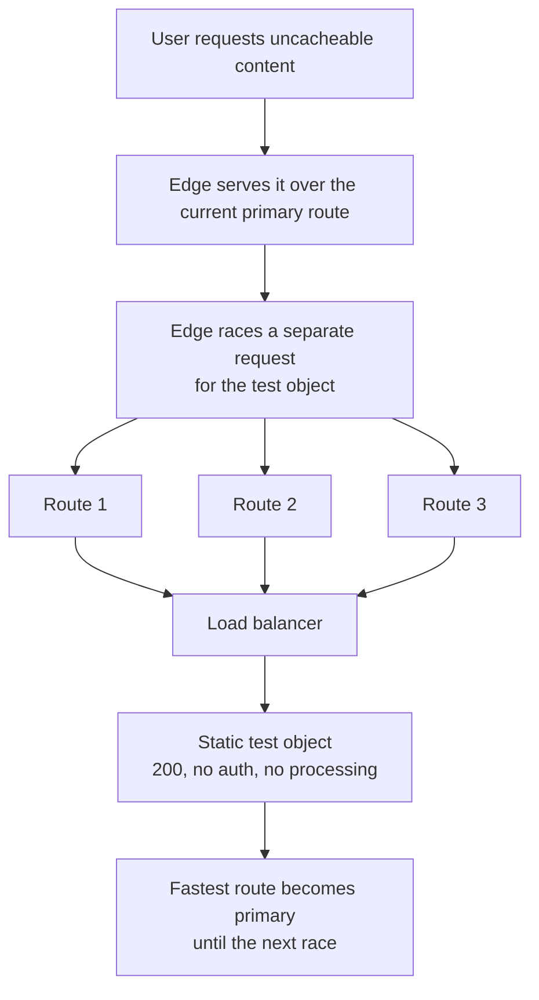

A user three time zones away loads a page and it feels quick. Nothing about that is an accident, and almost none of it is the application's doing. The part the application team contributes is a single static file that does nothing, and getting that file wrong is the easiest way to switch the whole thing off without noticing.

<!-- more -->

The feature is Akamai SureRoute. It tests several network paths between the edge and the origin and sends real traffic down the one that performed best. This post is the application side of it, because that is the side I keep having to explain.

## 1. The internet does not route for speed

Traffic between two points on the internet takes a path chosen by routing protocols, and those protocols optimise for reachability and policy, not for how fast your page feels. The default path works. It is frequently not the quickest one available.

SureRoute's answer is to stop assuming. A request for content that cannot be served from cache triggers a race: the edge fetches a small test object from the origin over three candidate routes at once, and the winner becomes the primary route until the next race. Results are held for a while — around half an hour by default — then re-raced.

Note what that excludes. Cacheable content is already served from the edge, so it never races and does not need to. **This feature only ever helps the requests that have to reach your origin**, which in a modern application is the API calls and the personalised responses — exactly the ones a user notices waiting for.

!!! example "Why I stopped explaining this as a CDN feature"

    When I describe it as "the CDN makes your site faster", application teams hear caching, and reasonably conclude it is somebody else's problem.

    Describing it as route selection for the requests that cannot be cached lands differently, because those are the requests the team already gets complaints about. The page shell was never the slow part. The call behind the spinner was.

## 2. The whole of the application team's job is one static file

Here is the entire contribution, and it is genuinely this small: serve a static test object the edge can fetch to run its races.

| Requirement | Why |
|---|---|
| Returns HTTP 200 | A race with a failed fetch measures nothing |
| Static, no back-end processing | The measurement is of the network path, not your application |
| No authentication | The edge fetches it without credentials |
| Content type `text/html`, a few KB of plain text | It needs to resemble a real uncacheable response in size |
| Same origin hostname as the real traffic | A path to a different host is a measurement of the wrong path |

That last row is the one that catches people. The object has to sit behind the same hostname as the traffic being optimised, because otherwise you have measured a route you are not using. Where several origins sit behind a load balancer, the balancer can serve the object itself.

!!! example "The file that broke the measurement by being helpful"

    The failure I would expect — and the reason I now review this file specifically — is someone making it useful. A test object that queries a database, or returns a dynamically generated timestamp, or checks downstream dependencies, is no longer measuring the network. It is measuring your application and attributing the result to a route.

    Worse, it fails in the direction that looks like success: every route now appears slow and roughly equal, so the race picks something close to arbitrary and the feature quietly stops helping. Nothing is red. There is no alert for "your route optimisation has become a coin toss".

## 3. Boring is the specification, not a shortcut

This is the part that sits badly with application engineers, and I understand why. We spend our working lives being told endpoints should validate, authenticate, log and report. Here the requirement is the opposite: return the same bytes immediately, every time, to anyone who asks, and do nothing else.

It is worth being precise about why that is safe. The object is a few kilobytes of static text with no information in it. It exposes no data because it contains none. The thing that would make it dangerous — making it reveal something about the system — is also the thing that would make it useless.

!!! example "The review comment I expect to write forever"

    Any suggestion to add logging, a version string, build information or a dependency check to this file gets the same answer: every one of those makes the measurement worse and the file more interesting to an attacker, which is the wrong direction on both counts.

    The one change I would accept is making it the right *size*. It should resemble a real uncacheable response, because a race against a trivially small file does not exercise the path the way real traffic will.

## 4. It is not your health check

The two get conflated constantly, including in how this was first described to me, and they are different objects with incompatible requirements.

A health check is supposed to be opinionated: it should check the database, verify dependencies and fail when the instance is unfit to serve. A race test object must do none of that. Pointing route optimisation at a health check endpoint gives you a measurement polluted by everything that endpoint touches.

!!! example "Two files, named so nobody merges them"

    The thing I would insist on is that these are two separate files with names that make their purpose obvious, rather than one endpoint serving both duties.

    They will drift otherwise. Someone adds a dependency check to the health endpoint, correctly, for health-checking reasons — and if that endpoint is also the race target, they have degraded a performance feature while improving an operational one, with no way to know they did it.

## 5. What it costs

Being straight about this, because it does have a cost: the races put extra requests on the origin. They arrive looking like ordinary traffic, over the same ports with the same certificates, and they recur.

For a static file served without processing that is a small cost, and it is the price of the feature. But it means two things for the application team. The test object has to be cheap to serve, because it will be served more often than you expect. And if you are counting requests to the origin for capacity or for billing, some of them are races rather than users.

!!! example "Where I would look if origin request counts looked wrong"

    If someone asked me why origin request volume did not match user analytics, race traffic is on the short list of explanations — along with health checks, uptime monitoring and crawlers.

    None of those are users, all of them hit the origin, and a team that does not know they exist will spend an afternoon looking for the missing people.

## Takeaways

- **Route optimisation only helps uncacheable requests.** Cacheable content comes from the edge already. That makes this an API-latency feature, not a page-weight one.
- **The application team's contribution is one static file**, served over the same hostname as the real traffic.
- **It must be dull by specification**: 200, static, unauthenticated, no processing, a realistic few kilobytes. Every improvement makes it worse.
- **It is not a health check**, and sharing one endpoint for both guarantees one of them gets degraded by a reasonable change to the other.
- **Races add origin traffic.** Keep the file cheap, and remember that some requests in your origin counts were never people.

What I do not have is a way to tell whether it is working. A good race and a broken one produce the same colour of nothing: no error, no alert, traffic flowing. You can infer it from latency over time, which is slow and confounded by everything else that changes. A check that fetches the test object and asserts it is still static, still unauthenticated and still the right size would catch the common regression, and I have not built it.
