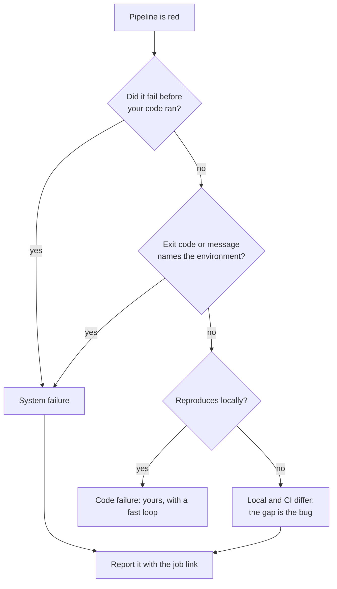

A green pipeline contains nothing worth reading. Nobody opens the log of a passing build, and they are right not to. All of the value in a pipeline's output is in the failures, and almost none of that output is arranged to help.

<!-- more -->

So this is about the failures, and specifically about one question worth asking before you read anything: **did my code fail, or did the thing running my code fail?** Those are different problems with different owners, and the fastest way to waste an afternoon is to start debugging one while looking at the other.

To be clear about where the difficulty comes from: build logs are hard to read because they are the raw output of a dozen tools that were never asked to produce something a person would read. That is a property of the logs, not of the people reading them. Platform engineers get quick at it only by having seen a few thousand of them, which is not a skill anyone should have to acquire by attrition.

## 1. Two kinds of red, and they are not interchangeable

| | Code failure | System failure |
|---|---|---|
| What happened | Your change did not do what it should | The environment running your change gave up |
| Example | A failing assertion, a type error, a lint finding | A runner out of memory, a registry timeout, a full disk |
| Who can fix it | You | The platform team |
| Useful next step | Read the error, reproduce locally | Report it, with the job link |

Telling these apart first is not a formality. If it is a code failure, everything you need is in the log and the fix is yours. If it is a system failure, there is nothing in your diff to find, and the most productive thing you can do is hand it to whoever owns the runners — with the job link, which saves them the only tedious part.

!!! example "The failure that taught me to write this down"

    For a long stretch the most common message in our platform channel was some version of *"my tests are failing with exit code 137 and I did not change anything."*

    Exit code 137 means the process was killed, nearly always because it ran out of memory. The tests were fine. The test runner was being killed mid-suite because the job shared a small machine with a build step that ate the available RAM.

    What strikes me now is that every person who asked was doing the right thing: they read the log, found nothing about their code in it, and asked someone. The cost was that they each spent twenty minutes first, checking a change that was never the problem, because nothing in the output said *this is not about your code*.

## 2. The signals, in the order they are quickest to check

Four checks, roughly in ascending order of effort. Most failures are settled by the first two.

**Which step failed?** Before reading any output, look at *where* it stopped. A failure in checkout, dependency install, container pull or image build — anything before your code is executed — is a system failure almost by definition. Your code had not run yet.

**What is the exit code?** A few are diagnostic on their own. `137` is a process killed, usually for memory. `143` is a termination signal, often a timeout or a cancelled job. Anything about "no space left on device", DNS, connection refused or a registry name is infrastructure, whatever step it appeared in.

**Did your change touch the thing that broke?** A failure in a module your diff does not reach is worth a second look before you accept it as yours. It can still be yours — a shared dependency, a changed interface — but the question is cheap to ask.

**Does it reproduce?** Run the same target locally. If it fails locally too, it is yours and you now have a fast loop. If it passes locally and fails only in the pipeline, the gap between the two environments is the actual bug, and that gap is usually the platform's.

!!! example "Why 'which step' comes first"

    The reason I put the step before the output is that the output is long and the step name is one word. Checking it costs a second and resolves a large share of failures on its own.

    It is also the check people skip, because a wall of red text pulls your eye into reading it. The habit worth building is to look at *where* it stopped before reading *what* it said.

## 3. Read the log from the end, but do not stop at the end

The last lines of a failing job are often the least useful: a runner cleaning up, a summary count, a non-zero exit being reported by something three layers removed from the cause.

What you want is the *first* line that is a real error rather than a consequence of one. Everything after the original failure tends to be wreckage — cascading errors, teardown problems, a test runner reporting that it could not write a report for a suite that already died.

So: start at the bottom to confirm it failed and how, then search upward for the earliest thing that looks like a root cause. In a long log, searching for the first occurrence of an error marker gets you closer than scrolling ever will.

!!! example "The shape of a log that wastes your time"

    The pattern I see most often is a job whose final two hundred lines are all consequence. A dependency failed to resolve early, every subsequent step failed because the dependency was missing, and the visible end of the log is the last of those downstream failures.

    Read from the bottom and you are looking at the fifth symptom. The actual line you need is far above, and it is usually short and unremarkable — which is exactly why it does not catch the eye.

## 4. Re-running is a test, not a remedy

Clicking re-run is reasonable when you have a reason: you believe it is a system failure and want to know whether it is transient. That is a hypothesis being tested.

What is worth avoiding is re-running as the first move, before looking at anything, because that is where two costs come from. It delays the fix on a code failure by the length of a pipeline run. And on a genuine system failure it destroys the evidence — the next run may land on a different machine, and the thing the platform team needed to see is gone.

If you are going to re-run a job you think is broken infrastructure, it is worth copying the job link somewhere first. That link is the difference between a report someone can act on and a conversation that starts with "it was red earlier".

!!! example "What makes a report immediately actionable"

    From the other side of this, the reports I can act on straight away have three things: the job link, what step failed, and whether it has happened more than once. That is thirty seconds of effort and it skips an entire round trip.

    The ones that take longest are not badly written — they are usually just "the pipeline is broken", sent by someone being considerate about not writing a long message. The irony is that the short version costs them more time than the detailed one would have.

## 5. Most of this should not be the developer's job

Everything above is a workaround. A developer should not need a mental decision tree to find out whether a failure is theirs, and the fact that this post can exist is a criticism of the tooling rather than a gap in anyone's knowledge.

What the platform side can do, roughly in order of how much it helps:

- **Label the failure class in the job itself.** If a wrapper can recognise exit code 137, it can print one line saying the job was killed for memory, that this is a runner problem rather than a code problem, and where to report it.
- **Name jobs after what they check**, so the step name alone carries information: `unit-tests` rather than `stage-3`.
- **Put the first real error at the top of the output**, or in the merge request annotation, so the log is a reference rather than a search problem.
- **Make the failure class visible across runs**, so a recurring system failure is a number somebody owns rather than a run of individual support messages.

!!! example "The cheap fix that worked better than the real one"

    With the memory failure, the real fix was giving test jobs their own memory limit, and we did that. But the change that stopped the support requests arrived the same day and was much smaller: a wrapper step that caught exit code 137 and printed one line — *this job was killed for exceeding memory. This is a runner problem, not your code. See link.*

    Nobody had needed the fix in order to carry on with their day. They had needed to know it was not theirs.

## Takeaways

- **Ask which kind of failure it is before reading the log.** Code failure, yours; system failure, the platform's. The answer usually takes seconds.
- **Check which step failed before reading its output.** Anything that broke before your code ran is not about your code.
- **Learn a handful of exit codes.** `137` is out of memory, `143` is a termination signal, and anything naming disk, DNS or a registry is infrastructure.
- **Find the first real error, not the last one.** The end of a failing log is usually wreckage.
- **Re-run to test a hypothesis, not as a reflex** — and save the job link before you do, or the evidence goes with it.
- **The tooling should answer this, not the reader.** Every category a wrapper can recognise is a category nobody has to learn.

What I have not solved is where the labels should live. Printing them in the log helps the person reading it and does nothing for the person who never opens it. Putting them in the merge request helps more people and means the pipeline has to know something about the code review system. I have built neither properly, which is why this post is still a reading guide rather than a description of something automatic.
