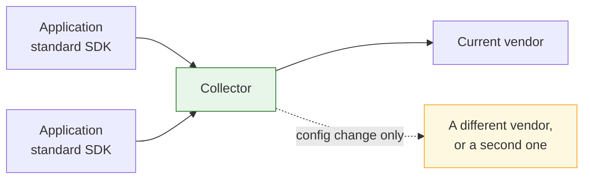

Consolidating observability onto a single vendor is usually described as one decision. It is two, and they have very different lifespans. One is where the data goes, which is a contract you will renegotiate. The other is how the data is produced, which is code in every service you own.

<!-- more -->

I have written before about moving our logging to a new platform and what that cost. The part I did not cover is what came after: metrics followed the logs onto the same vendor, so one platform now holds both halves of the picture instead of two vendors holding one each.

What made that comfortable rather than nervous is that the instrumentation did not move with it. Applications emit telemetry in a standards-based form, not in a vendor's own, and the vendor sits at the end of the pipeline as a destination. That distinction is the whole point of this post, because it is the difference between a contract you can leave and a migration you will be quoted for.

## The two decisions

| Decision | Who it binds | How long it lasts |
|---|---|---|
| Where telemetry is stored and queried | The platform team, commercially | Until the next renewal |
| How telemetry is produced in the application | Every service and every team | Until someone rewrites them |

Most of the pain people describe as "vendor lock-in" is the second row dressed up as the first. If a vendor's agent and SDK are compiled into two hundred services, changing vendor is a change to two hundred services, and the renewal conversation is not really a conversation. If those services speak a standard protocol instead, moving is a change to one piece of configuration in the middle.

## 1. Consolidating the destination is a real win, and a small one

Two vendors holding logs and metrics separately is a genuine problem, and not mainly a financial one. It means two query languages, two sets of dashboards that cannot be put next to each other, two notions of what a service is called, and an incident where someone reads a graph in one tab and a log line in another and holds the correlation in their head.

Putting both on one platform removes that seam. Metrics and logs for the same service sit in the same place, under the same service name, and the step from a spike on a chart to the log lines underneath it is a click instead of a context switch.

The maintenance side matters just as much and gets less attention. One platform means one set of credentials, one integration to keep working, one agent to upgrade, one access model to review, one place where somebody has to understand how retention is configured. Everything a second vendor adds to the estate, the platform team carries.

!!! example "What this looked like for me"

    Metrics moved onto the same platform as the logs, and what I noticed first was not the dashboards but the reduction in things to maintain. There was one fewer integration to keep alive and one fewer place to go when someone asked who has access to what.

    The dashboard benefit arrived more slowly and was more valuable. Being able to put a metric and its logs on the same page, without translating a service name between two tools, changed what people were willing to build.

## 2. Keep instrumentation on the standard, deliberately

The decision that makes the first one safe is separate and has to be made on purpose, because the easy path points the other way. Every vendor ships an SDK and an agent, both are well documented, both are the fastest route to data on a screen, and both put their name inside your application.

The alternative is to instrument against the open standard — OpenTelemetry, in practice — and let the vendor receive it. Applications use the standard's SDK and semantic conventions and emit over its protocol. A collector sits in the middle and forwards to whatever backend is configured.

The dotted line is the entire argument. With that shape, changing or adding a backend is a change at the collector. Without it, the dotted line runs through every service instead, and it stops being a line on a diagram and becomes a programme of work.

There is a second benefit that shows up sooner than any migration. Semantic conventions mean a service name, an HTTP route or an error attribute is called the same thing everywhere, by specification rather than by local convention. That consistency is what makes a dashboard generated across services work at all.

!!! example "The part I would not compromise on"

    Our instrumentation is standards-based rather than vendor-specific, and I would hold that line even if a vendor's own SDK were slightly easier on a given day.

    The reason is not principle. It is that I have already seen what the other kind of change costs, in the logging move, and that one did not even touch application code.

## 3. Where the lock-in actually sits

Here is the honest part, and the reason I called the win in section one small.

Standards-based instrumentation moves your data. It does not move anything you built on top of your data. Dashboards, alerts and saved queries are written in a vendor's query language against a vendor's data model, and none of that is covered by any standard. In our logging migration, rebuilding the monitors was the bulk of the actual effort — far more than the pipeline change — and an open protocol on the way in would not have saved a single one of them.

So the accurate claim is narrow. Keeping instrumentation on the standard means a vendor change costs you dashboards and alerts. Not keeping it means a vendor change costs you dashboards, alerts, and a code change in every service, coordinated across every team's roadmap. The second is what makes a migration undoable. The first is merely expensive.

| What a vendor change costs you | With standards-based instrumentation | With a vendor SDK everywhere |
|---|---|---|
| Shipping telemetry somewhere new | Collector configuration | A change in every service |
| Field and service naming | Already by specification | Re-derived per service |
| Dashboards and alerts | Rebuilt | Rebuilt |
| Query fluency in the team | Relearned | Relearned |

The bottom two rows do not improve. Anyone telling you a standard makes vendors interchangeable is skipping those rows.

!!! example "Why I keep making this point"

    What I take from the logging migration is that the invisible work was the monitoring, not the data. The forwarder change was an afternoon.

    That is why I describe consolidation as buying consolidated dashboards and easier maintenance, and not as buying freedom. The freedom part is bounded, and the boundary is the dashboards.

## 4. What stays vendor-shaped anyway

Two more things are worth saying plainly, because the clean diagram above is not the whole estate.

Not every signal arrives through the collector. Infrastructure-level and platform-level data often comes from a vendor's own agent or a direct integration, because that is the only supported path. Those pieces are vendor-shaped and they are fine, as long as you know which parts of the picture they are and do not assume the collector covers everything.

And a vendor's distinctive features are distinctive for a reason. Correlation, automatic topology, anything that infers relationships for you — that is what you are paying for, and using it is sensible. It is also, by definition, not portable. The judgement is to keep that in the layer you can rebuild, on top of the data, rather than letting it reach back into how applications are written.

## Takeaways

- **Separate the two decisions.** Where telemetry is stored is commercial and renegotiable. How it is produced lives in your code.
- **Consolidating the destination buys consolidated dashboards and less to maintain.** One integration, one access model, one place to look during an incident.
- **Instrument against the open standard on purpose.** The vendor's SDK is the faster path and the one that costs most to undo.
- **Semantic conventions pay off before any migration,** by making names consistent enough to generate dashboards across services.
- **The remaining lock-in is dashboards, alerts and fluency,** and no standard addresses it. Claim what is true and not more.
- **Expect some signals to stay vendor-shaped.** Know which ones rather than assuming the collector has everything.

What I cannot yet put a number on is the cost side. The consolidation was driven in part by commercial reasons and I believe it was the right call, but I have not measured it properly — one bill replacing two is not the same as spending less, once you account for the volume that follows metrics into a single platform. Until I have that, I would rather describe what it bought operationally than claim a saving I have not checked.
